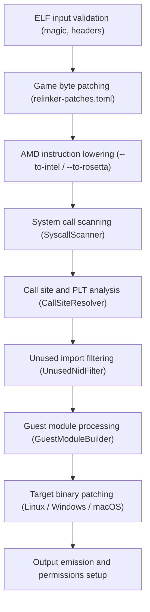

import { Aside } from '@astrojs/starlight/components';

The relinker (`core/relinker`) translates PlayStation 5 ELF executables and bundled modules into native host executables.

The pipeline starts with input validation and optional byte patching. The tool then translates AMD-specific instructions into Intel or Rosetta equivalents, scans for disallowed system calls, resolves import call sites, and filters unused symbols. It then converts bundled guest modules and writes the final patched native executable.

## Pipeline stages

### 1. Header parsing and validation

The `ElfReader` component reads the first 64 bytes (`0x40`) of the main executable and verifies the ELF identification bytes: `0x7f`, `'E'`, `'L'`, `'F'`, 64-bit architecture (`ELFCLASS64`), and little-endian encoding (`ELFDATA2LSB`). It reads the program header table and ensures loadable segments (`PT_LOAD`) conform to valid alignment boundaries.

### 2. Module discovery and backup filtering

`Cli::ReadModules` discovers bundled modules in `sce_module/`, `sce_modules/`, or `prx/`. It validates that both singular and plural folders do not coexist. It reads the ELF headers of candidate modules and filters backup copies: if a filename extends another module's name in the same folder and shares its internal `SONAME`, the backup file is skipped. Unwrapped ELF files are queued for conversion; encrypted SELF containers are skipped with a warning.

### 3. Byte patching

When `relinker-patches.toml` or ``--patches <file>`` is provided, `GamePatch::PatchTarget` applies byte-level substitutions. Patches are validated before application:
- Target bytes in the binary must match the `expected` values.
- Patch ranges must lie entirely within a `PT_LOAD` segment.
- Patch ranges must not overlap ELF headers, relinker trampolines, or relocation targets.

### 4. AMD instruction lowering

PlayStation 5 software targets an AMD Zen 2 CPU. When running on an Intel CPU or under macOS Rosetta 2, certain AMD-specific instructions cause illegal instruction faults.

When `--to-intel` or `--to-rosetta` is enabled:
- `IAmd64OnlyConverter` scans executable segments.
- Supported AMD-specific instructions are rewritten in place where length allows.
- Where replacements require additional bytes, the converter allocates jump trampolines to synthetic code stubs appended to an allocated section.
- Under `--to-rosetta`, instructions unsupported by Rosetta (such as `ANDN`, `RDSEED`, `CLWB`, and `XSAVEOPT`) are lowered to equivalent scalar operations.

### 5. System call scanning

PlayStation 5 games execute in user mode and communicate with the kernel through library calls rather than direct syscalls. The `SyscallScanner` examines executable segments for `syscall` or `sysenter` machine instructions.

- Any unexpected raw system call halts conversion to prevent unhandled kernel traps at runtime.
- When `--trap-sdk-syscall-stubs` is passed, known ps5-payload-dev wrapper sequences are rewritten with `UD2` instructions (generating an illegal instruction fault if reached) rather than halting conversion.

### 6. Call site and PLT resolution

The `CallSiteResolver` inspects dynamic relocation entries (`DT_RELA`, `DT_JMPREL`), Procedure Linkage Table (PLT) call sites, and Global Offset Table (GOT) slots. It identifies external library dependencies (`DT_NEEDED`) and records every imported 11-character NID symbol.

### 7. Unused NID filtering

The `UnusedNidFilter` optimizes symbol tables according to the `unused-filter` parameter:

- `unused-filter=0`: Preserves all declared imports.
- `unused-filter=1`: Performs control-flow and GOT access analysis. Non-PLT imports that are never referenced in reachable code are removed; PLT imports are preserved.
- `unused-filter=2`: Applies strict whole-program reachability analysis and compacts the PLT table, eliminating unreferenced stubs.

### 8. Target binary generation

Depending on the selected operating system, a dedicated patcher constructs the native container:

- **Linux (`LinuxElfPatcher`)**: Constructs an `ET_EXEC` ELF binary fixed at virtual base address `0x400000` (within the 40-bit memory window required by `sceLibcMspaceCreate`). It embeds the runtime library search path (`$ORIGIN/libs`) into `DT_RPATH`.
- **Windows (`WindowsPePatcher`)**: Generates a 64-bit PE32+ executable. It maps the entry point, sets up base relocations (`.reloc`), configures the subsystem (console or GUI), creates the import directory for runtime PRX libraries, and embeds `icon0.png` as an application icon resource.
- **macOS (`MacOsMachOPatcher`)**: Builds an x86-64 Mach-O binary. It prepends a 64 KiB `__PAGEZERO` segment and sets `@loader_path` rpath definitions.

### 9. Output emission and guest artifacts

The writer emits the main executable and saves converted bundled modules into `app0/sce_module/`. On Linux, executable file permission bits (`0755`) are applied automatically. If `--registry` was specified, call registry JSON manifests and `.needed.json` dependency graphs are written beside the binaries.
