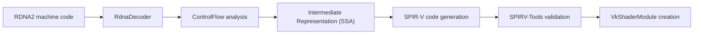

import { Aside } from '@astrojs/starlight/components';

PlayStation 5 titles submit command buffers containing compiled GPU shader code targeting AMD RDNA2 hardware. The AnyPS5 shader recompiler (`core/shader/recompiler`) translates these shaders at runtime into standard Vulkan SPIR-V bytecode.

## Translation pipeline

The shader compilation pipeline progresses through five stages:

1. **Instruction decoding (`RdnaDecoder`)**: Reads raw 32-bit and 64-bit instruction words and decodes them into strongly-typed C++ opcode structures defined in `RdnaOpcode.hpp`. The decoder supports all 1,166 RDNA2 instruction encodings listed in `tools/rdna_isa.txt`.
2. **Control-flow analysis (`ControlFlow`)**: Reconstructs structured loops, conditional execution blocks, and subroutine calls from unstructured branching instructions (`S_CBRANCH`, `S_BRANCH`).
3. **Intermediate representation (`IntermediateRepresentation`)**: Builds a static single-assignment (SSA) graph (`IrBlock`, `IrValue`, `IrOpcode`). In this stage, vector register allocations (`GuestRegister`) map to virtual variables, dead code is eliminated, and expression trees are normalized.
4. **SPIR-V emission**: Translates SSA operations into SPIR-V intermediate instructions conforming to the Vulkan 1.1 specification.
5. **Validation and optimization**: When compiled with `ANYPS5_ENABLE_SPIRV_TOOLS`, the generated SPIR-V passes through Khronos SPIRV-Tools to verify bytecode validity and apply optimization passes before passing to `vkCreateShaderModule`.

## Pipeline journal and caching

Shader compilation occurs on demand when draw or dispatch calls encounter new shader binaries. To prevent runtime stutter:

- **Shader cache (`shader_cache/`)**: Translated SPIR-V modules and Vulkan driver pipeline caches are saved in `shader_cache/` beside the executable. Entries are organized in subdirectories named after the recompiler's source version.
- **Pipeline journal (`pipelines.journal`)**: Records every unique graphics and compute pipeline configuration, including blend states, vertex input layouts, rasterization modes, and specialized shader modules. On subsequent launches, AnyPS5 replays the journal across background worker threads during title startup, pre-compiling pipelines before they are reached during gameplay.

## Validation rules for contributors

Because shader instruction behavior must match console hardware:

- Pull requests that add or modify shader instruction semantics must state where the behavior was verified: measured on physical hardware (specifying the test GPU and parameters) or cited from the official AMD RDNA2 ISA documentation, LLVM AMDGPU backend, or Mesa ACO compiler.
- Reviewers verify shader modifications against the hardware oracle test harness (`tools/hw-oracle/test_hw_oracle.py`).
- Testing AGC and shader changes requires running Vulkan validation layers (`VK_INSTANCE_LAYERS=VK_LAYER_KHRONOS_validation`) with shader caching disabled (`ANYPS5_NO_SHADER_CACHE=1`) to ensure no `VUID-` validation errors are introduced.
