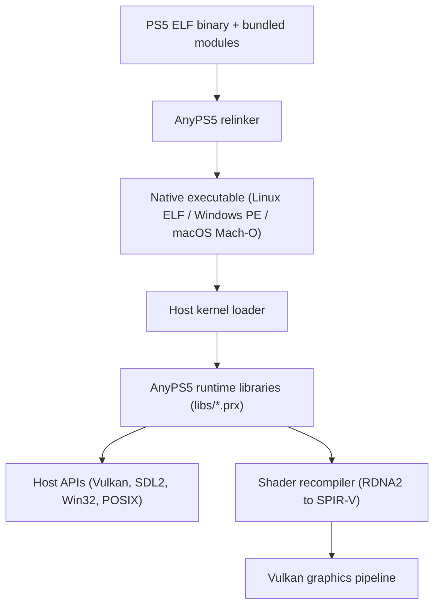

import { Aside } from '@astrojs/starlight/components';

AnyPS5 executes PlayStation 5 applications on standard PC hardware by eliminating the runtime emulation layer. The system relies on two main components: an offline relinker and a collection of host runtime dynamic libraries.

The conversion flow starts with clean PlayStation 5 ELF binaries and bundled modules. The relinker translates the container into a native executable format. At startup, the host operating system loads the binary and links it against AnyPS5 host PRX libraries. Graphics commands route through the AGC driver and shader recompiler into standard Vulkan calls.

## The relinker

The relinker (`core/relinker`) converts the input binary file format. A PlayStation 5 executable is an ELF64 binary with custom segment definitions, dynamic tags, and symbol resolution tables based on 11-character alphanumeric hashes called NIDs (Numeric Identifiers).

The relinker performs the following tasks:

1. Validates the input executable header and verifies that bundled guest modules in `sce_module/`, `sce_modules/`, or `prx/` are intact.
2. Identifies imported symbols, dynamic relocation entries, and Procedural Linkage Table (PLT) call sites.
3. Rewrites AMD Zen-specific instructions when targeting Intel or Rosetta environments via `--to-intel` or `--to-rosetta`.
4. Filters unused symbol imports according to the requested `unused-filter` optimization level.
5. Emits a target executable:
   - For Linux: an `ET_EXEC` ELF binary fixed at virtual base `0x400000` (or a custom base set with `--linux-fixed-base`).
   - For Windows: a PE32+ executable with relocations, dynamic base settings, and an embedded `icon0.png` asset.
   - For macOS: an x86-64 Mach-O executable with a `__PAGEZERO` segment.

## Runtime system libraries (PRX)

PlayStation 5 games do not make raw operating system kernel calls directly; they link dynamically against system PRX libraries. AnyPS5 reimplements these libraries in `core/libs/prx` as standard host shared libraries (using `.prx` as their file extension).

When a converted application starts:

- On Windows, the dynamic loader loads PRX libraries compiled as Windows PE dynamic libraries from the `libs/` directory.
- On Linux, the ELF dynamic linker loads PRX libraries using the embedded rpath (`$ORIGIN/libs`).

### Calling convention bridging

PlayStation 5 executables compile for the System V AMD64 ABI, where the first six integer or pointer arguments pass in registers `rdi`, `rsi`, `rdx`, `rcx`, `r8`, and `r9`.

- On Linux and macOS, the host operating system uses the System V AMD64 ABI natively, allowing direct execution of function calls without register shuffling.
- On Windows, the host toolchain uses the Microsoft x64 calling convention (`rcx`, `rdx`, `r8`, `r9`). AnyPS5 PRX function declarations use the `APS5_VABI` macro (`__attribute__((sysv_abi))`), instructing GCC to generate prologues and epilogues that conform to the System V calling convention.

<Aside type="note">
System PRX libraries are not byte-for-byte copies of console libraries. They are clean-room implementations written in C++20 that map console services to host facilities like SDL2, standard POSIX or Win32 threads, and Vulkan.
</Aside>

## Shader recompilation

PlayStation 5 titles submit GPU command buffers containing machine code for AMD RDNA2 graphics hardware. AnyPS5 translates this code at runtime using its shader recompiler (`core/shader/recompiler`).

The shader recompiler operates as follows:

1. Decodes AMD RDNA2 GPU instructions into an intermediate representation.
2. Translates the intermediate representation into Vulkan-compatible SPIR-V bytecode.
3. Validates the generated SPIR-V through Khronos SPIRV-Tools when built with `ANYPS5_ENABLE_SPIRV_TOOLS`.
4. Saves compiled shaders and pipeline states in the local `shader_cache/` directory to avoid re-translating shaders on subsequent runs.
