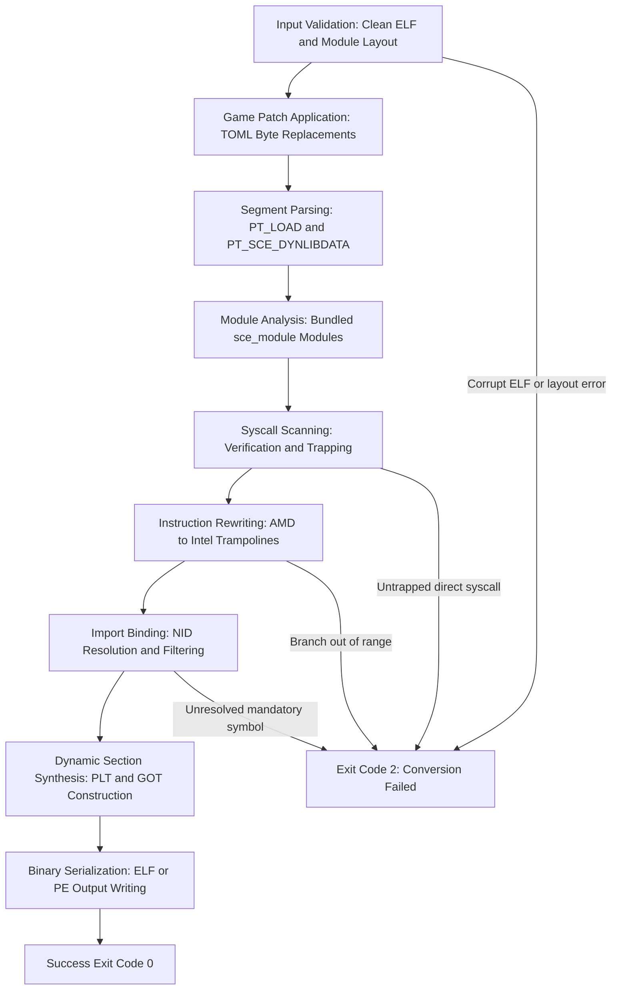

The relinker converts PlayStation 5 ELF binaries into host-compatible Linux ELF or Windows PE executables. This pipeline operates entirely ahead-of-time without emulation or runtime virtualization.

## Conversion stages

### Stage 1: Input validation

The pipeline begins by validating input arguments and filesystem structure:

- The input file must be an unencrypted, valid 64-bit ELF executable. Encrypted SELF binaries must be decrypted with tools like `tools/unwrap_self.py` before execution.
- The relinker checks for bundled modules next to the input executable. Exactly one of `sce_module/` or `sce_modules/` must exist. If both or neither exist, the relinker terminates.

### Stage 2: Game patch application

If the `--game-patch` option is provided, the relinker reads the specified TOML patch definition. Patches apply in file order directly to the raw binary bytes of target `PT_LOAD` segments before disassembly or module inspection. If an expected byte pattern does not match or a patch overlaps protected header space, conversion fails immediately.

### Stage 3: Segment parsing

The parser reads the program headers, decoding:

- `PT_LOAD` segments containing executable code, initialized data, and uninitialized BSS sections.
- `PT_SCE_DYNLIBDATA` segments specific to PlayStation binaries containing module tags, import lists, and NID tables.
- `.eh_frame` and `.eh_frame_hdr` sections providing DWARF exception unwind tables used to map function boundaries.

### Stage 4: Bundled module inspection

The relinker inspects each ELF module found inside `sce_module/`. Modules that provide game engine code or middleware (such as audio engines or font renderers) are processed as guest modules. The relinker verifies that host reimplementations in `core/libs/prx` are not redundantly registered for symbols provided by the game's own modules.

### Stage 5: Syscall scanning and validation

The relinker scans executable instructions across code segments:

- Direct `syscall`, `sysenter`, or `int 0x80` opcodes are detected.
- If `--trap-sdk-syscall-stubs` is passed, recognized `ps5-payload-dev` and inline SDK stubs are rewritten to `UD2` instructions.
- If any untrapped direct kernel instructions remain, conversion halts with an error.

### Stage 6: Instruction rewriting

On x86-64 platforms, PlayStation 5 code may contain AMD-specific instructions or optimization sequences. When `--to-intel` is enabled, the relinker analyzes branch destinations and instruction encodings, replacing incompatible sequences with standard Intel-compatible trampolines.

### Stage 7: Import resolution and NID filtering

The relinker reads imported symbols referenced by NID hashes and maps them to host PRX libraries:

- NID hashes are matched against the export databases of `core/libs/prx`.
- The `unused-filter` setting determines which symbols are retained:
  - `unused-filter=0`: Retains all declared imports.
  - `unused-filter=1`: Strips imports never referenced in code.
  - `unused-filter=2`: Strips unused imports and prunes non-essential libraries from `DT_NEEDED`.

### Stage 8: Dynamic section synthesis

The relinker synthesizes a clean System V dynamic table:

- Generates host `DT_NEEDED` records pointing to target `.prx` libraries.
- Constructs Procedure Linkage Table (PLT) stubs and Global Offset Table (GOT) entries matching the host format.
- Injects `DT_RPATH` or `DT_RUNPATH` records (defaulting to `$ORIGIN/libs` on Linux) to guarantee runtime dynamic linker resolution.

### Stage 9: Output serialization

The final stage serializes the converted program:

- Linux output: Emits an ELF executable with updated program headers, segment alignments, and interpreter paths.
- Windows output: Emits a Portable Executable (PE) 64-bit binary with PE headers, section headers, import address tables, and System V ABI calling convention attributes.

## Pipeline exit codes

The relinker communicates status through standard process exit codes:

| Exit code | Meaning | Description |
| :--- | :--- | :--- |
| `0` | Success | The executable was converted successfully, and all output files were written. |
| `1` | Invalid arguments | Incorrect CLI flags, missing required positional arguments, or mutually exclusive options. |
| `2` | Conversion failed | Pipeline error during parsing, invalid ELF headers, untrapped syscalls, or unresolvable relocations. |
